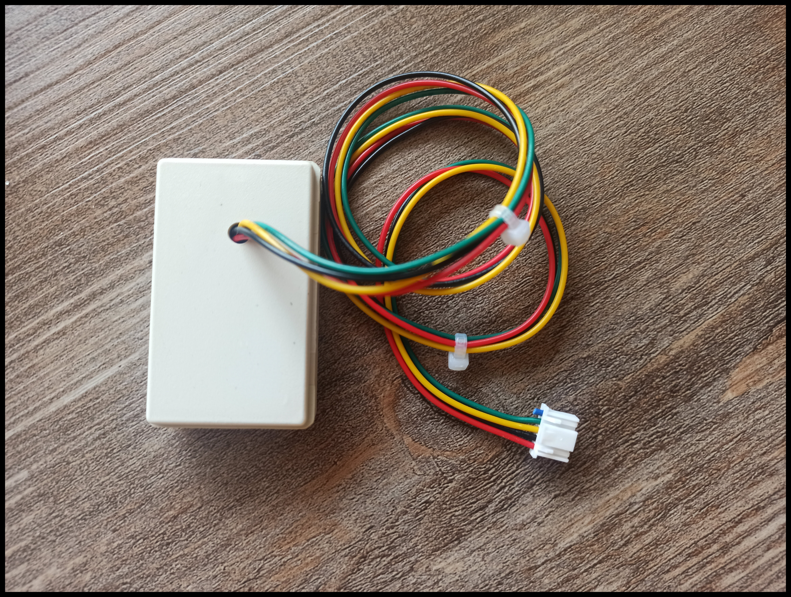

# CN105-2HA for Mitsubishi air conditioners
Controller for **Mitsubishi air conditioner** for **Home Assistant**

  

A cable with a **CN105** connector combined with an electronic circuit allows you to control most **Mitsubishi air conditioners** via home automation (Home Assistant, Jeedom…). This cable is relatively difficult to find and often at a high price.

It is based on **Echavet** software, and **ESP32 C3 Super Mini** controller.

🔵 Actual versions : Hardware : 2.0 ---- Software : 1.1

⚫ Installation procedure :  [Here](Documentation)

🟡 Last versions of the code : [Here](Code)

🟢 If you want to modify the script (Config_ESP32.yaml) yourself, [Click here](Documentation/Modifications_by_yourself.pdf) to read **Documentation/Modifications_by_yourself.pdf**.

 

> [!NOTE]
> **05/22/2026** : Several users have told me that at the startup, the **CN105-2HA** module sometimes does not connect properly to the **Mitsubishi** device. The workaround is to trigger the **CN105-2HA** module reset procedure using the entity : **button.clim_x_restart**.
>
>  

> [!NOTE]
> **Software 1.2** ([Code/ESP32_C3_V1_2.yaml](Code/ESP32_C3_V1_2.yaml)) : the same firmware for every module.
> - **No module index to choose** : each module names itself from its MAC address (for example **CLIM a7bf68**), so several modules never collide. Rename it as you like when you add it in Home Assistant.
> - **Room temperature chosen in Home Assistant** : the module has a **Remote temperature** entity. Import the blueprint below, create one automation per module, and pick the module and its room sensor(s). Several sensors are averaged; °F / °C is converted automatically. To change the sensor later, just edit the automation — no re-flashing.
>
> 
>
> If the automation stops sending values (sensor unavailable, Home Assistant down), the indoor unit falls back to its own temperature sensor after 30 minutes. Modules on software 1.1 keep working as before (they read **sensor.my_room_temperature**).
>
>  

# 🚨 Over 1 300 controllers sold worldwide !

 
 

# Compatible Air Conditioners

> ###  ✅ The following air conditioners are known to work with the **CN105-2HA** module.
>
> ### 🔍 This list is **not exhaustive** and is based on user feedback and successful installations.
>
> ### If your Mitsubishi Electric air conditioner has a **CN105 connector** on the indoor unit control board, there is a very very high probability that the **CN105-2HA** module will be compatible.

> ### To date, I have not encountered any model equipped with a CN105 connector that was not compatible.

---

## ✅ Confirmed Compatible Models

### MFZ Series

* MFZ-KA09NA

### MLZ Series

* MLZ-KP12NA

### MSXY Series

* MSXY-FN10VE
* MSXY-FN13VE
* MSXY-FN24VE

### MSZ-AP Series

* MSZ-AP15VGK
* MSZ-AP20VGK
* MSZ-AP25VGK
* MSZ-AP35VGK
* MSZ-AP42VGK
* MSZ-AP50VGK
* MSZ-AP35VGD2

### MSZ-AY Series

* MSZ-AY20
* MSZ-AY25
* MSZ-AY35
* MSZ-AY42
* MSZ-AY50

### MSZ-DM Series

* MSZ-DM25VA
* MSZ-DM35VA

### MSZ-EF Series

* MSZ-EF09NA
* MSZ-EF15NA
* MSZ-EF35VEB
* MSZ-EF42VE
* MSZ-EF50VE

### MSZ-FH Series

* MSZ-FHxxNA

### MSZ-FS Series

* MSZ-FSxxNA

### MSZ-FT Series

* MSZ-FT50VG2

### MSZ-GE Series

* MSZ-GE22VA
* MSZ-GE24NA
* MSZ-GE35VA

### MSZ-GL Series

* MSZ-GL06NA
* MSZ-GL09NA
* MSZ-GL12NA
* MSZ-GL15NA
* MSZ-GL18NA
* MSZ-GL24NA

### MSZ-GS Series

* MSZ-GS12NA

### MSZ-HR Series

* MSZ-HR25VF
* MSZ-HR35VF
* MSZ-HR45VF
* MSZ-HR50VF

### MSZ-LN Series

* MSZ-LN35VGW

### MSZ-SF Series

* MSZ-SF35VE3
* MSZ-SF50VE3

### PEFY Series

* PEFY-P32VMA-E2

### SEZ Series

* SEZ-KD25VAQ
* SEZ-M50DAL

---

## ⚠️ Special Cases

### PEH-6EAK

**Please contact me before ordering.**

This is an older model that requires a slightly different configuration.

### MSZ-A24NA

**Please contact me before ordering for compatibility confirmation.**

---
